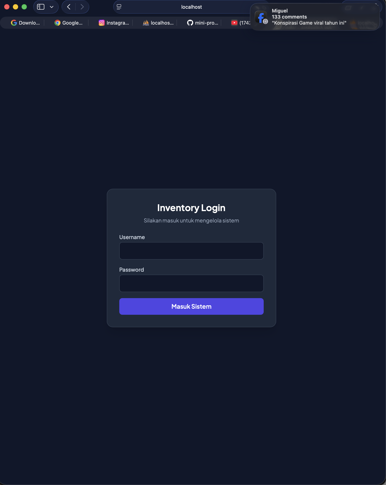
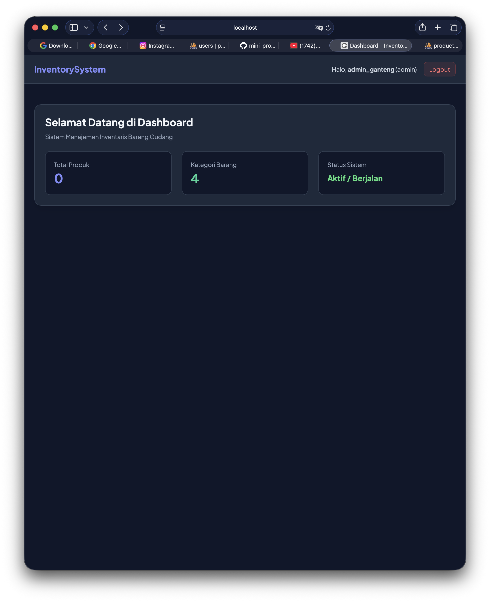
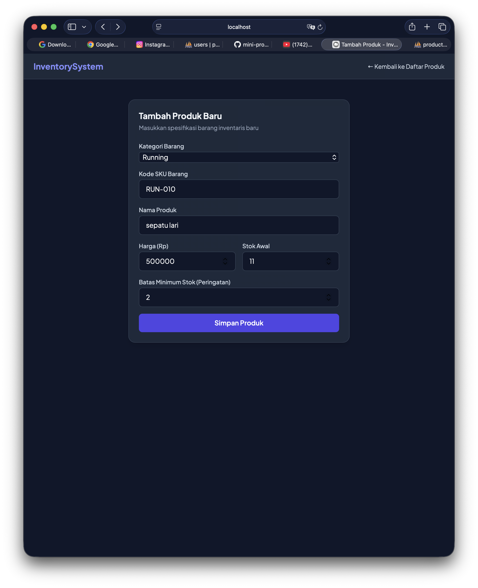
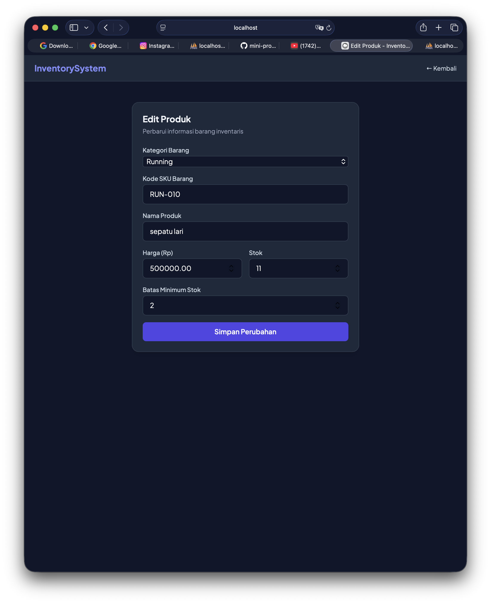
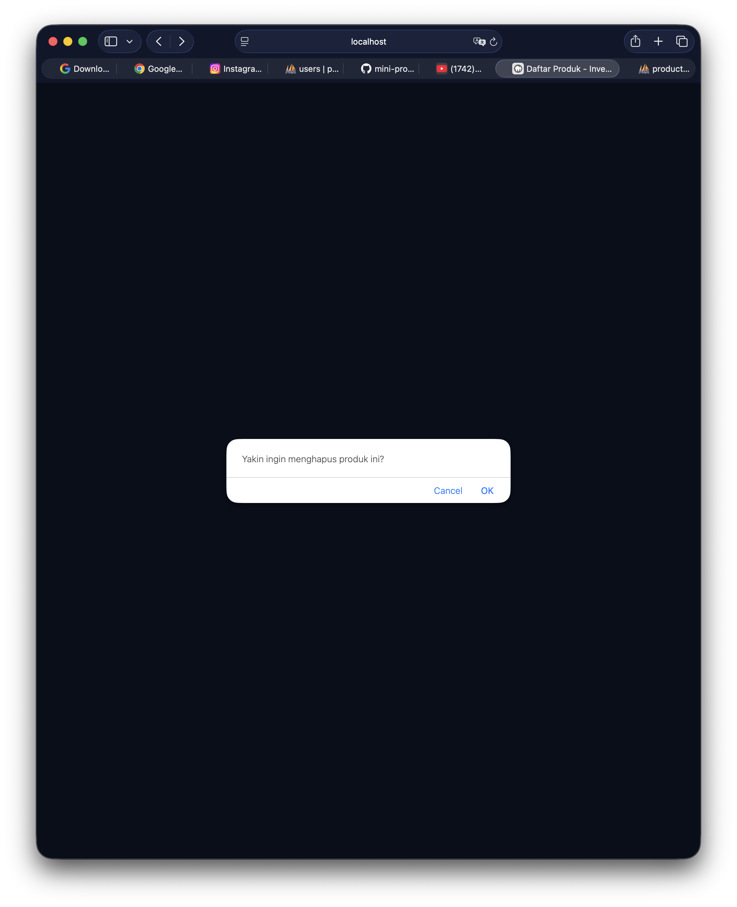
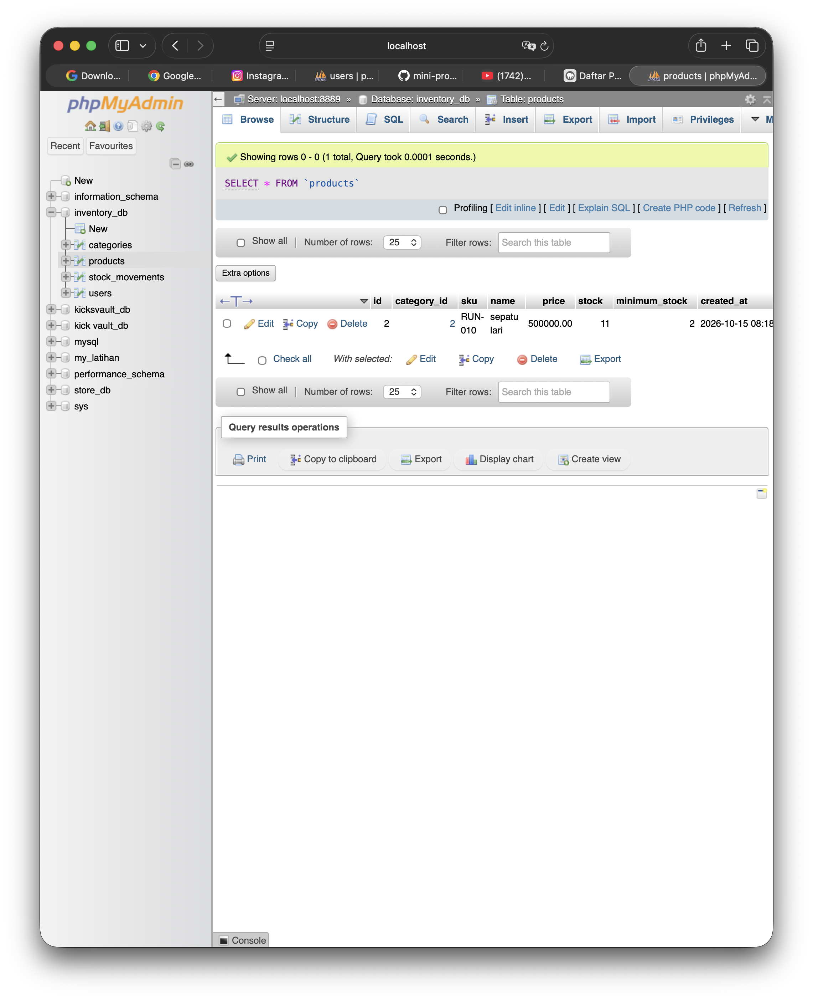

# Inventory Management System - Mini Project 3

Proyek manajemen inventaris barang berbasis web menggunakan PHP, MySQL, dan Tailwind CSS.

## 🚀 Akses Web Melalui Browser

Pastikan Anda sudah mengaktifkan server MAMP (Apache & MySQL). Buka browser favorit Anda lalu akses:

`http://localhost:8888/public/login.php`

## 📸 Screenshot Aplikasi

Berikut adalah tampilan dari fitur-fitur yang ada di dalam aplikasi:

### 1. Halaman Login

### 2. Dashboard & Daftar Produk

### 3. Tambah Produk

### 4. Edit Produk

### 5. Hapus Produk

### 6. Database (MAMP)

## 📄 Lisensi
Proyek ini dibuat untuk keperluan akademis mata kuliah **Pemrograman Web** (Mini Project 3).
